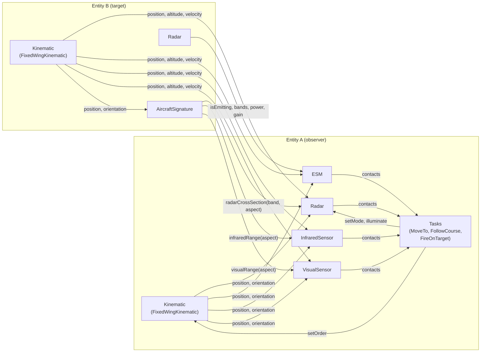

# Model interactions

How the standard models work together during a simulation. Each model page has a
**Dynamic behaviour (pseudo-code)** section; this page shows how those pieces call one another.

The archetypes only carry data. The behaviour below is a reference for the simulations and tools
that use the library; the simulation stays free of its detection and flight models, as long as it
honours the data and constraints.

## Who reads whom



| Model | Reads | Read by |
|---|---|---|
| [`Kinematic`](kinematic.md) | — | sensors (own entity and targets), its entity's signature, tasks |
| [`FixedWingKinematic`](fixed-wing-kinematic.md) | orders from tasks | same as `Kinematic`, plus tasks (arrival, fuel) |
| [`Signature`](signature.md) | its entity's kinematic (in derived signatures) | sensors of the other entities |
| [`AircraftSignature`](aircraft-signature.md) | its entity's kinematic (aspect) | `Radar` (RCS), `InfraredSensor` (`Infrared`), `VisualSensor` (`Visual`) of the other entities |
| [`Sensor`](sensor.md) | own kinematic, targets' kinematics | tasks and triggers of its entity |
| [`Radar`](radar.md) | targets' signatures (RCS per band) | `ESM` of the other entities; weapons and `FireOnTarget` (illumination) |
| [`ESM`](esm.md) | targets' radars (emission) | tasks and triggers (threat warning) |
| [`InfraredSensor`](infrared-sensor.md) | targets' signatures (`Infrared`) | tasks and triggers |
| [`VisualSensor`](visual-sensor.md) | targets' signatures (`Visual`) | tasks and triggers |

Detection is never symmetric: a radar sees a target through the target's **signature** (two-way
propagation), while the target's ESM hears that radar through the radar's **emission** (one-way
propagation), usually much farther. A radar in `Off` mode is invisible to ESM; infrared and visual
sensors are always silent.

## Simulation loop

```text
createEntity(archetype, scenarioValues)
    entity = new Entity(archetype)
    for equipment in [archetype.Kinematic] + archetype.Equipments      # kinematic first
        data = resolve(equipment)        # base chain defaults, then derived defaults,
                                         # then entity overrides, then scenario values
        check data against all constraints (Min/Max with value or ref, ListOfValues, Pattern)
        equipment.init(entity, data)
    return entity

tick(t, dt)
    # 1. decisions: tasks read the contacts of the previous tick and give orders
    for entity in world.entities
        for task in entity.activeTasks
            task.step(t, dt)             # e.g. MoveTo -> kinematic.setOrder(...)
                                         #      FireOnTarget -> radar.setMode(Track), radar.illuminate(target)

    # 2. movement: every kinematic moves, so all sensors see the same instant
    for entity in world.entities
        entity.kinematic.step(t, dt)

    # 3. perception: every sensor scans the world as it is after movement
    for entity in world.entities
        for sensor in entity.equipmentsOfType(Sensor)
            sensor.step(t, dt)           # reads target kinematics, signatures, emitters

    # 4. triggers: activation and exit triggers of the tasks are evaluated on the new state
    for entity in world.entities
        evaluateTriggers(entity, t)
```

Moving every entity before any sensor scans keeps the result independent of the order in which
entities are stored. Signatures have no step: they answer queries from the current kinematic state.

## Example: two fighters meet

A Rafale (`RBE2Radar` in `Search`, `SpectraESM`, `OSFIrst`) flies towards an F-35A whose
`APG81Radar` the scenario sets to `Off` (emission control; its default mode is `Search`).

```text
t = 0     Rafale RBE2 emits (Search). F-35A ASQ239ESM:
              RBE2 bands I, J ∩ ESM bands -> not empty
              received power (one-way) >= Sensitivity -> contact: bearing only, emitter "RBE2Radar"
          Rafale RBE2 -> F-35A: RCS = F35ASignature.RadarCrossSectionEToM[Front] (very small)
              radar equation snr < threshold -> no detection
t = 120   distance has shrunk; still no radar detection of the F-35A (stealth in E-M bands)
          Rafale OSFIrst -> F-35A: infraredRange(Front) * generationFactor >= range -> contact
          (no range information: OSFIrst capabilities have no RangeInformation)
t = 150   F-35A task FireOnTarget: APG81Radar.setMode(Track), illuminate(Rafale)
          Rafale SpectraESM now hears APG81 (if LPI loss does not hide it) -> threat warning
          Rafale task triggers react (evade, counter-attack)
```

## Pseudo-code conventions

- Indentation delimits blocks; `#` starts a comment.
- `data.X` is the resolved value of the data item `X` of the equipment: the most derived default
  value, overridden by the entity, then by the scenario.
- `a ?? b` is `a` when it is set, `b` otherwise. `clamp(x, lo, hi)` bounds `x`;
  `approach(x, target, step)` moves `x` towards `target` by at most `step`.
- `owner` is the entity carrying the equipment; `owner.kinematic` its kinematic;
  `entity.equipmentOfType(T)` the equipment whose definition derives from `T`.
- `init(entity, data)` runs once when the entity is created; `step(t, dt)` runs at each simulation
  tick; other functions are queries or orders called by other models.
- `dB(x) = 10 log10(x)`; `dBm(P) = dB(P in mW)`.
- Names in lowerCamelCase that are not data items (`detectionThreshold`, `turnRateOf`,
  `generationFactor`, `weather`...) are simulation functions or constants, not archetype data.
